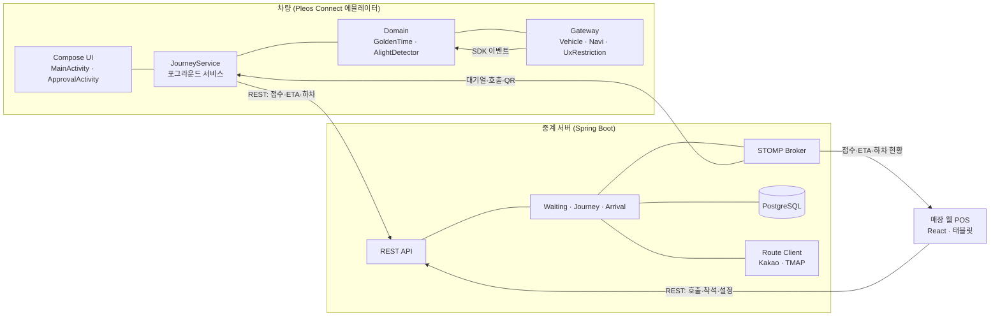
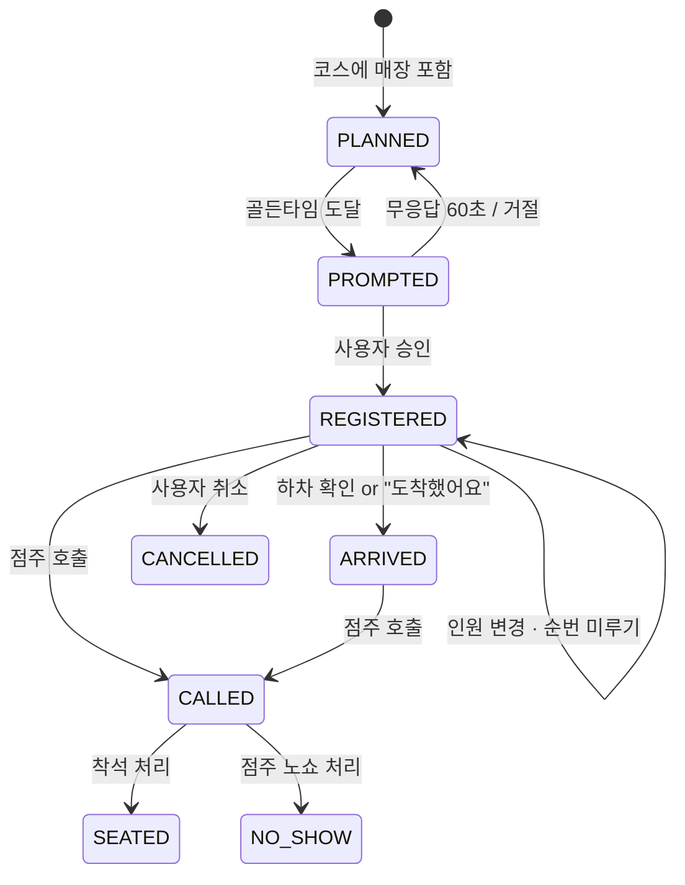
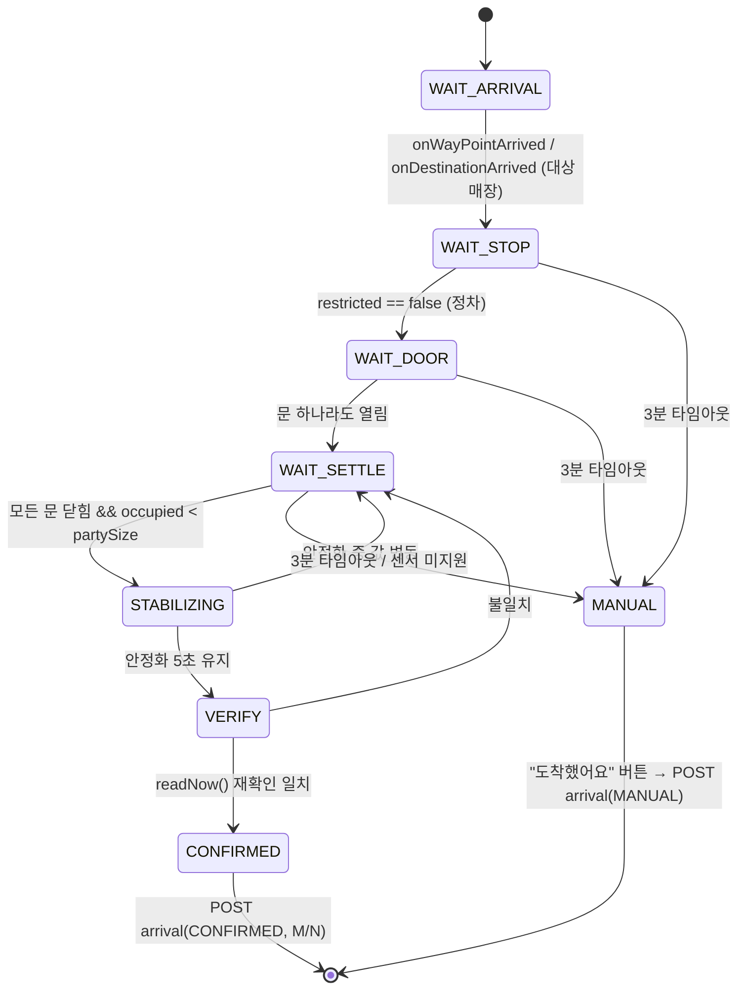

# 플레오스 스마트 저니 (Smart Journey) 개발 명세서 v3.1

> 수정일: 2026-11-10. v2 기획서(PRD·기능명세·정책)를 **바로 개발에 들어갈 수 있는 형태**로 재구성했습니다.
> 바뀐 것: 기술 스택 확정(Spring Boot), 아키텍처·모듈 구조, API·이벤트 명세, 상태 머신, 알고리즘 파라미터, 우선순위 백로그, 일정.
> 제품 방향("차량이 증명하는 웨이팅")과 정책은 v2를 그대로 따릅니다.
> **v3.1 (11/10 오후)**: 앱 동작 방식을 "플레오스 뒤에서 도는 백그라운드 엔진 + 필요할 때만 뜨는 접점"으로 정리(2.1절), NaviHelper API 이름을 공식 문서 기준으로 교정(4.2절), 경로 API 키는 P1 코스 최적화에서만 쓰도록 단계 조정, TMAP 웹 지도는 P2 선택 사항으로 추가, 착수 전 확인 목록 재정렬.

## 목차
0. v2 → v3 변경 요약
1. 기술 스택 결정
2. 시스템 아키텍처
3. 저장소(모노레포) 구조
4. 차량 앱 설계 (Kotlin)
5. 핵심 로직 명세 (골든타임 · 하차 확인 · 인원 변동)
6. 백엔드 설계 (Spring Boot)
7. 매장 웹 POS 설계 (React)
8. 주행 규제(DO) 설계
9. 우선순위 백로그 + 인수 조건
10. 일정 (11/10 – 12/04)
11. 테스트 시나리오 (Virtual Console E2E)
12. 착수 전 확인 목록 (미확정 항목)
부록 A. 제품 요약 (v2 발췌)

---

## 0. v2 → v3 변경 요약

| 구분 | v2 | v3 |
| --- | --- | --- |
| 중계 서버 | FastAPI + WebSocket | **Java 21 + Spring Boot + STOMP over WebSocket** |
| 차량 앱 | Kotlin (구조 미정) | **Kotlin + Jetpack Compose**, SDK를 인터페이스로 감싸고 Fake 구현 제공 |
| 매장 POS | React (태블릿) | **React + TypeScript + Vite (웹)**. React Native는 차량 앱에 쓰지 않음 (1장 참고) |
| 하차 확인 | 조건 나열 | **상태 머신 + 기본 파라미터(안정화 5초, 타임아웃 3분)** |
| 골든타임 | 공식만 | **입력·출력·재계산 주기·중복 방지 규칙** 명시 |
| 대기시간 | "매장 대기시간 수신" | **앞 팀 수 × 팀당 분(매장 설정) / 점주 수동 덮어쓰기** 로 정의 |
| 주행 중 승인 | "규제 범위 내에서" | **승인 카드 전용 Activity만 DO 선언**하는 구조 제안 + 카테고리 재검토 |
| 경로 API 키 | 미정 | 카카오·TMAP 호출은 **서버에서만**, 그리고 **P1-2 코스 순서 최적화에서만** 사용. P0는 키 없이 동작 (v3.1) |
| 앱 동작 방식 | 앱 화면 중심 | **백그라운드 엔진(JourneyService) 중심**. 운전자는 앱을 열지 않고 승인 카드·음성만 접함 (2.1절, v3.1) |
| 내비 연동 API | `requestRouteWithWaypoints`, `requestTrip` | 공식 문서에서 확인된 **`requestRoute` + `addWaypoint`**, ETA는 **`onTripInfo` 콜백**(요청 함수는 에뮬레이터 확인) (4.2절, v3.1) |
| 지도 | - | **지도를 새로 만들지 않음.** 길 안내·지도 화면은 플레오스 내장 내비가 담당 (2.1절, v3.1) |
| 우선순위 | 기능 12개 동일 비중 | **P0 7개 / P1 3개 / P2 2개** |
| Vehicle SDK | 문서 예시 2.0.3 | **제공본 2.3.2 기준** 시그니처·권한·deprecated 정리, 안전벨트 신호 추가 (4.5절) |

> ✅ 공식 접수양식 5.1절의 "FastAPI" 표기는 Spring Boot로 수정 완료.

---

## 1. 기술 스택 결정

### 1.1 차량 앱 — 후보 비교

Pleos Connect는 AAOS 기반이고, Pleos Connect SDK(Vehicle, NaviHelper 등)는 Gradle로 받는 Android 라이브러리입니다. 샘플·가이드도 Kotlin/Java 기준이고, 에뮬레이터도 Android Studio AVD로 돌립니다.

| 순위 | 선택지 | 판단 | 이유 |
| --- | --- | --- | --- |
| **1** | **Kotlin + Jetpack Compose** | ✅ 채택 | SDK·CarUxRestrictionsManager를 그대로 호출. Activity 단위 DO 선언, 멀티윈도우 리사이즈, 포그라운드 서비스 등 AAOS 기능을 막힘 없이 씀. Java 경험이 있으면 학습 비용 낮음 |
| 2 | Kotlin + XML View | 가능 | 안정적이지만 대형 카드·상태 전환 UI 작성이 Compose보다 느림 |
| 3 | React Native + 네이티브 모듈 | ❌ 비권장 | APK는 나오지만 **핵심 로직이 전부 네이티브 SDK 호출**이라 Kotlin 브리지를 어차피 다 짜야 함. 공식 문서에 RN 언급 없음, 심사·디버깅 리스크, JS 런타임 리소스 부담. 얻는 것 대비 비용이 큼 |
| 4 | Flutter | ❌ | RN과 같은 이유 |

**결론: 차량 앱 = Kotlin + Compose.** React(Native) 경험은 매장 POS 웹에서 그대로 살립니다.

### 1.2 전체 스택

| 계층 | 기술 | 비고 |
| --- | --- | --- |
| 차량 앱 | Kotlin, Jetpack Compose, Coroutines/Flow, Hilt, Retrofit+OkHttp, Krossbow(STOMP 클라이언트), DataStore | minSdk ≥ 23 (Vehicle SDK 최소값), 실제 값은 Pleos 에뮬레이터 이미지 API 레벨에 맞춤 |
| Pleos SDK | **Vehicle SDK 2.3.2** (공모전 제공본, 4.5절), NaviHelper SDK 3.0.5, AAOS `CarUxRestrictionsManager`, Gleo App Schema | Vehicle 2.3.2는 차량/에뮬레이터의 Vehicle 서비스 **2.3.13 이상** 필요 |
| 백엔드 | Java 21, Spring Boot(3.5.x 또는 4.0.x 중 하나로 고정), Spring Web, Spring WebSocket(STOMP), Spring Data JPA, Validation, Flyway, springdoc-openapi | Swagger UI를 심사 자료로 활용 가능 |
| DB | PostgreSQL 16 (로컬은 Docker), 테스트는 Testcontainers | 데모 규모면 Redis 불필요 |
| 매장 POS | React 18+, TypeScript, Vite, @stomp/stompjs, TanStack Query, Tailwind | 태블릿 가로 모드 기준 |
| 외부 API (P1) | 카카오모빌리티 다중 경유지 API 또는 SK TMAP API 중 **하나** | 서버에서만 호출. P1-2 착수 시점(11/23)에 키 발급. P0에는 불필요 |
| 배포(데모) | Docker Compose (api + db + pos) → 클라우드 VM 1대, HTTPS/WSS | 로컬 백업: 에뮬레이터에서 `10.0.2.2:8080` |

---

## 2. 시스템 아키텍처



**통신 원칙**
- **명령은 REST**, **상태 변화 알림은 STOMP 구독**. 클라이언트는 재연결 시 REST로 현재 상태를 다시 받아 맞춘다(이벤트 유실 대비).
- 차량 → 서버로 보내는 값은 정책 4에 따라 **ETA(분), 인원, 하차 인원, 도착 여부, 웨이팅 정보만**. 좌표·궤적은 보내지 않는다.

### 2.1 동작 원칙 — 플레오스 뒤에서 도는 앱

스마트 저니는 **지도를 새로 만들지 않는다.** 길 안내와 지도 화면은 플레오스 내장 내비가 맡고, 우리 앱은 NaviHelper로 목적지·경유지를 넣고 남은 시간과 도착 이벤트를 받아 오기만 한다. 운전자는 평소처럼 내비를 보며 달리고, 앱은 뒤에서 판단하다가 **결정이 필요한 순간에만** 나타난다.

| 층 | 역할 | 구성요소 | 운전자에게 보이나 |
| --- | --- | --- | --- |
| 1. 백그라운드 엔진 | 내비 ETA·도착 이벤트 구독, 좌석·벨트·도어 감시, 골든타임 계산, 하차 확인, 서버(STOMP) 연결 유지 | `JourneyService` (포그라운드 서비스) | 상태 알림 한 줄만 |
| 2. 필요할 때만 뜨는 접점 | 골든타임 승인, 인원 변경 제안, 순번 미루기, 하차 결과, 호출 시 QR | Gleo 음성, `ApprovalActivity`(승인 카드) | 순간적으로 |
| 3. 정차 중에만 여는 화면 | 처음 동의, 인원 확인·수정, 코스 입력, 진행 현황 | `MainActivity` | 사용자가 열 때만 |

**접점을 띄우는 순서** (위에서부터 시도, 안 되면 다음으로)

| 순위 | 방식 | 장점 | 확인할 것 |
| --- | --- | --- | --- |
| 1 | Gleo 음성 ("지금 A 맛집 웨이팅 걸까요?" → "응") | 화면을 볼 필요가 없음 | `schema.json` 검수 승인, 응답 범위. TextToSpeech SDK는 준비 중 |
| 2 | 알림 + full-screen intent로 승인 카드 표시 | 백그라운드에서 화면을 띄우는 표준 방식 | 플레오스에서 full-screen intent가 허용되는지, 주행 중 표시 정책 |
| 3 | 서비스가 `ApprovalActivity`를 직접 실행 | 구현이 단순 | Android 백그라운드 Activity 실행 제한에 걸릴 수 있음 |

- 세 방식 모두 승인 결과는 같은 도메인 이벤트(`ApprovalGranted` / `ApprovalDeferred`)로 엔진에 돌아간다. 화면과 음성은 같은 규칙(정책 2)을 따른다.
- 엔진은 **정차 중 `MainActivity`에서 "여정 시작"을 한 번 누르면** 켜지고, 마지막 매장 착석·취소 또는 여정 종료 시 꺼진다. 앱 창을 닫아도 엔진은 계속 돈다.
- 상태 알림에는 "A 맛집 · 골든타임까지 12분"처럼 한 줄만 보여 준다.

---

## 3. 저장소(모노레포) 구조

```
smart-journey/
├─ vehicle-app/                 # Android Studio 프로젝트 (Kotlin)
│  ├─ app/                      # Activity, Compose 화면, Hilt 설정
│  ├─ core-vehicle/             # Seat·Door·CarUxRestrictions 래퍼 (+ Fake)
│  ├─ core-navi/                # NaviHelper 래퍼 (+ Fake)
│  ├─ core-network/             # Retrofit, STOMP, DTO
│  └─ domain/                   # 순수 Kotlin: GoldenTimeCalculator, AlightDetector, 상태 머신
├─ server/                      # Spring Boot (Gradle, Java 21)
│  └─ src/main/java/.../
│     ├─ waiting/  journey/  arrival/  store/  consent/  route/
│     └─ common/ (ws, error, config)
├─ pos-web/                     # React + Vite + TS
├─ docs/                        # 이 명세서, API 문서 export, 시연 시나리오
├─ apk/                         # 팀명_앱이름_release.apk (가산점)
├─ docker-compose.yml
└─ README.md                    # 앱 소개, 실행 방법, 테스트 환경, APK 위치
```

> **저장소 규칙** (GitHub `smartjourney-pleos/smart-journey`, public)
> - 브랜치: `main`(제출·심사용) ← `develop`(통합) ← `feature/기능명`. `main`·`develop`은 보호 규칙(삭제 금지, 강제 푸시 금지, PR로만 병합)이 걸려 있어 직접 푸시 불가.
> - 머지는 머지 커밋 또는 스쿼시만, 머지된 브랜치는 자동 삭제.
> - public이므로 **API 키·DB 비밀번호·`local.properties`·`.env`는 커밋 금지**. 첫 커밋에 Android/Spring/Node 공용 `.gitignore`를 넣는다.
> - 공식 가이드에 실명 비공개(블라인드) 규칙은 없다. 다만 커밋 이메일 노출이 싫으면 GitHub noreply 이메일을 쓴다.

---

## 4. 차량 앱 설계 (Kotlin)

### 4.1 화면·컴포넌트

| 구성요소 | 역할 | DO 선언 |
| --- | --- | --- |
| `JourneyService` | **앱의 본체.** 포그라운드 서비스. SDK 리스너, 골든타임 계산, 하차 감지, STOMP 연결 유지, 접점 띄우기(2.1절) | - |
| `ApprovalActivity` | 대형 단일 승인 카드 1장 (골든타임 · 인원 변경 · 순번 미루기). 엔진이 띄우고 승인 후 바로 닫힘 | ✅ (8장 참고, 확인 필요) |
| `MainActivity` | 동의, 인원 확인/수정, 코스 설정, 여정 시작, 진행 현황, QR | ❌ (정차 전용) |

화면은 Pleos 가이드에 따라 **세로(창 1개) 기본 + 가로(창 2개) 확장**을 모두 지원하고, 창 크기가 바뀌어도 깨지지 않게 만든다.

### 4.2 SDK 래퍼 (테스트·시연 안정성의 핵심)

SDK를 직접 화면·도메인에서 부르지 않고 인터페이스 뒤에 숨긴다. 에뮬레이터 신호가 불안정하거나 SDK를 못 읽을 때 **Fake로 같은 흐름을 시연**할 수 있다.

```kotlin
interface VehicleGateway {
    suspend fun capabilities(): VehicleCaps            // checkSeatOccupancyCapabilities, checkSeatBeltBuckledCapabilities, checkDoorPositionCapabilities (CapabilityConfig 반환형)
    val occupiedCount: Flow<Int?>                      // getCurrentSeatOccupancy + registerSeatOccupancy, 영역별 Boolean 합산
    val buckledCount: Flow<Int?>                       // getCurrentSeatBeltBuckledState + registerSeatBeltBuckledState (보조 신호, 4.5절)
    val anyDoorOpen: Flow<Boolean?>                    // getCurrentDoorPosition + registerDoorPosition, 승객 문(ROW_n)만, 위치 > 닫힘 최소값이면 열림
    suspend fun readNow(): VehicleSnapshot             // 확정 직전 재확인용 즉시 읽기
}

interface DrivingStateGateway {
    val restricted: Flow<Boolean>                      // CarUxRestrictions.isRequiresDistractionOptimization()
}                                                      // 읽기 실패 시 true(규제 중) 방출

interface NaviGateway {
    val trip: Flow<TripInfo>                           // onTripInfo 콜백 → remainingMin (요청 함수·필드명은 에뮬레이터 확인, 없으면 getRouteStateInfo → onRouteStateInfo)
    val arrivals: Flow<ArrivalEvent>                   // onDestinationArrived / onWayPointArrived
    suspend fun setRoute(dest: Place, waypoints: List<Place>): Result<Unit>
        // requestRoute(RouteInfo) → onRoutingCompleted 대기 → addWaypoint(FIRST/SECOND) → onWaypointChanged/onWayPointInfo로 확인. 경유지 ≤ 2
}
```

- 구현체: `PleosVehicleGateway`, `PleosNaviGateway`, `CarUxDrivingStateGateway` / `FakeVehicleGateway` 등.
- 빌드 변형(flavor) `real` / `fake` 로 분리. 디버그 메뉴에서 Fake 값을 직접 조작.
- SeatArea·DoorArea 목록은 **하드코딩하지 않고** SDK에서 지원 영역을 조회해 순회한다.
- **NaviHelper 호출 규칙 (공식 문서 확인, v3.1)**
  - `NaviHelper(context).initialize()` → `addListener(NaviHelperEventListener)` → 사용 → `removeListener` → `release()`.
  - 조회 API(`getRouteStateInfo`, `getDestinationInfo`, `getWaypointInfo` 등)는 값을 직접 돌려주지 않고 **콜백(`onRouteStateInfo` 등)으로만** 준다. → `callbackFlow` / `suspendCancellableCoroutine`으로 감싼다.
  - `requestRoute()`가 성공해도 경로 탐색이 끝난 게 아니다. `onRoutingCompleted()`를 받은 뒤에 경유지를 넣고, 실패는 `onError(NaviErrorCode)`로 받는다.
  - 경유지는 `WaypointIndex.FIRST`, `SECOND` 두 개까지. 전체 삭제는 `removeWaypoint(WaypointIndex.ALL)`.
  - 명세서 v3까지 쓰던 `requestRouteWithWaypoints`, `requestTrip`은 이번에 본 문서의 API 목록에 없다. 받은 SDK 버전에 있으면 써도 되지만 기본은 위 방식.
  - 지도 위에 마커·오버레이를 그리는 API는 없다. 웨이팅 상태는 접점(2.1절)과 앱 창에서만 보여 준다.

### 4.3 권한 (AndroidManifest)

| 권한 | 쓰는 곳 | 출처 |
| --- | --- | --- |
| `pleos.car.permission.CAR_SEATS` | 좌석 점유, 안전벨트 체결 | Vehicle SDK 2.3.2 `@RequiresCustomPermission` 확인 |
| `pleos.car.permission.CAR_DOORS` | 도어 위치 | 동일 |
| `ai.pleos.playground.service.vehicle.VEHICLE_BINDING` | Vehicle 서비스 바인딩 | **SDK 매니페스트가 자동 병합** (직접 안 적어도 됨) |
| NaviHelper 권한 (`NAVI_ROUTE`, `NAVI_ROUTE_SEARCH` 계열) | ETA, 경로 입력 | 패키지·권한 이름이 버전마다 바뀐 이력이 있음. 받은 SDK의 매니페스트에서 정확한 문자열 확인 |
| `android.permission.INTERNET`, `FOREGROUND_SERVICE`, `POST_NOTIFICATIONS`, `USE_FULL_SCREEN_INTENT` | 서버 통신, JourneyService, 상태 알림, 승인 카드 표시(2.1절 2순위) | Android 표준. 실제 필요 여부는 에뮬레이터 API 레벨에 맞춤 |

- `CAR_DRIVE`(기어)는 **쓰지 않는다.** Vehicle SDK의 Gear API 전체가 deprecated이고 "Google `GEAR_SELECTION` 속성을 쓰라"고 안내한다. 기어가 꼭 필요하면 AAOS `CarPropertyManager`의 `VehiclePropertyIds.GEAR_SELECTION`으로 읽는다.
- `CAR_SEATS`·`CAR_DOORS`가 런타임 요청 대상인지는 에뮬레이터에서 첫 실행 때 확인한다(거부 시 예외가 오면 수동 모드로 전환).

### 4.5 제공받은 Vehicle SDK 2.3.2 정리 (Downloads/Vehicle-2)

**받은 형태:** AAR 압축을 푼 폴더(`classes.jar`, `AndroidManifest.xml`, `proguard.txt`, `R.txt`, `res/`). 그대로는 Gradle에 못 넣으니 다시 AAR로 묶는다.

```bash
cd ~/Downloads/Vehicle-2 && zip -r ../vehicle-2.3.2.aar . -x '.*'
# → vehicle-app/app/libs/vehicle-2.3.2.aar 로 복사
```
```kotlin
// app/build.gradle.kts
dependencies { implementation(files("libs/vehicle-2.3.2.aar")) }
```
(Pleos Nexus `ai.pleos.playground:Vehicle` 에 2.3.2가 올라와 있으면 그걸 써도 됨. 두 방식을 섞지 않는다.)

**SDK 정보 (매니페스트에서 확인)**

| 항목 | 값 |
| --- | --- |
| SDK 버전 | 2.3.2 (versionCode 73) |
| 필요한 Vehicle 서비스 | 2.3.13 이상 (versionCode 65) → **에뮬레이터 이미지가 이보다 낮으면 동작 안 함** |
| minSdk | 23 |
| 패키지 | `ai.pleos.playground.vehicle` |

**진입점과 호출 방식**
- `val vehicle = Vehicle(context); vehicle.initialize()` → `vehicle.getSeat()`, `getDoor()` … 끝나면 `vehicle.release()`.
- 모든 조회는 **콜백 2개(성공, 실패)** 방식: `getCurrentSeatOccupancy(area, onSuccess: (Boolean)->Unit, onError: (Exception)->Unit)`. → 코루틴에서는 `suspendCancellableCoroutine`, 구독은 `callbackFlow`로 감싼다 (`03_개발/PleosVehicleGateway.kt` 참고).
- 영역은 `SeatArea(SeatValue.ROW_1_LEFT)`, `DoorArea(DoorValue.ROW_2_RIGHT)`처럼 만든다.

**우리가 쓰는 API (2.3.2 시그니처 기준)**

| 용도 | API | 콜백/리스너 | 권한 |
| --- | --- | --- | --- |
| 좌석 지원 여부 | `Seat.checkSeatOccupancyCapabilities((CapabilityConfig, List<SeatArea>) -> Unit, onError)` | `CapabilityConfig.accessType` (NONE/READ/WRITE/READ_WRITE) | CAR_SEATS |
| 좌석 점유 | `Seat.getCurrentSeatOccupancy(SeatArea, (Boolean)->Unit, onError)` | `registerSeatOccupancy(area, SeatOccupancyListener)` → `onSeatOccupancyUpdated(Boolean)` | CAR_SEATS |
| 안전벨트 (신규 활용) | `Seat.getCurrentSeatBeltBuckledState(SeatArea, (Boolean)->Unit, onError)` | `registerSeatBeltBuckledState(area, SeatBeltBuckledStateListener)` → `onSeatBeltBuckledStateUpdated(Boolean)` | CAR_SEATS |
| 도어 지원 여부 | `Door.checkDoorPositionCapabilities((CapabilityConfig, Map<DoorArea, AreaBounds<Int>>) -> Unit, onError)` | 열림 정도의 최소·최대값 | CAR_DOORS |
| 도어 위치 | `Door.getCurrentDoorPosition(DoorArea, (Int)->Unit, onError)` | `registerDoorPosition(area, DoorPositionListener)` → `onPositionUpdated(Int)` | CAR_DOORS |

**영역 값**
- 좌석 `SeatValue`: `ROW_1_LEFT/CENTER/RIGHT`, `ROW_2_*`, `ROW_3_*` (9개). 실제 지원 영역은 capability 결과로만 판단.
- 도어 `DoorValue`: `ROW_1_LEFT/RIGHT`, `ROW_2_*`, `ROW_3_*`, `HOOD`, `REAR`. **하차 판단에는 ROW_n 승객 문만** 쓰고 `HOOD`(보닛)·`REAR`(트렁크)는 뺀다.
- 도어 위치는 정수다. capability의 `AreaBounds` 최소값을 "닫힘"으로 보고, 그보다 크면 열림으로 판단한다.

**쓰지 말 것 (deprecated)**
- `Gear.*` 전체 → AAOS `GEAR_SELECTION`으로 대체
- 리스트만 돌려주는 옛 `checkSeatOccupancyCapabilities(List)`, `checkSeatBeltBuckledCapabilities(List)`, `checkDoorPositionCapabilities(Map)` → **`CapabilityConfig`를 같이 주는 새 오버로드**를 쓴다
- `DrivingMode`는 주행 모드·크루즈 정보라 정차 판별에 쓰지 않는다 (기존 원칙 유지)

**SDK에 있지만 이번엔 안 쓰는 것:** `Brake.getCurrentBrakePedalStatus`(브레이크 페달), `Safety`(에어백·벨트 경고), `Light`(앰비언트, 제어는 CONTROL 권한 필요), `HVAC`, `Window` 등.

### 4.4 로컬 상태

DataStore에 `deviceToken`, 동의 버전, 현재 journey/waiting ID, 마지막 ETA·대기시간을 저장 → 프로세스가 죽어도 복구 (Pleos 앱 수명주기 가이드 반영).

---

## 5. 핵심 로직 명세

모두 `domain/` 모듈의 순수 Kotlin 클래스로 만들고 **단위 테스트를 먼저 작성**한다.

### 5.1 웨이팅 상태 머신 (서버와 차량 공통)



### 5.2 골든타임 계산 (기능 2.1 · 정책 1)

**입력**
| 값 | 출처 | 기본값 |
| --- | --- | --- |
| `remainingMin` | `onTripInfo`(해당 경유지까지 남은 시간). 경유지별 값이 없으면 목적지 기준 값을 쓰고, 매장을 목적지로 두는 코스 구성으로 보정 | - |
| `waitMin` | 서버 `queue-status` (STOMP로 갱신) | - |
| `bufferMin` | 매장 설정 `arrivalBufferMin` | 10 |

**규칙**
```
target = waitMin - bufferMin
if target <= 0           → 즉시 PROMPT (대기가 짧아 지금 서도 늦지 않음)
else if remainingMin <= target → PROMPT
else                     → 대기, 남은 시간 = remainingMin - target 표시
```
- `trip` 또는 `waitMin`이 바뀔 때마다 재평가(이벤트 기반, 폴링 없음).
- **중복 방지**: 한 웨이팅당 PROMPT는 1회. 거절·무응답 후 재알림은 `remainingMin`이 추가로 5분 이상 줄었을 때 1회만.
- 값 수신이 60초 이상 끊기면 마지막 값으로 계산하고 UI에 "정확도 낮음" 표시.
- 예: 이동 60분·대기 30분 → target 20분 → 출발 40분 후 알림 → 호출은 30분 뒤, 도착은 20분 뒤 → 10분 여유.

### 5.3 하차 확인 (기능 6.2 · 정책 7) — 핵심 차별 기능



| 파라미터 | 기본값 | 설명 |
| --- | --- | --- |
| `settleSec` | 5 | 점유·도어 값이 유지돼야 하는 시간 |
| `timeoutSec` | 180 | 이 시간 안에 확정 못 하면 수동 버튼으로 전환 |
| 하차 인원 `M` | `clamp(partySize - occupiedNow, 0, partySize)` | 운전자가 남으면 M = N-1 |

- `occupiedNow == 0`(운전자 포함 전원 하차)이면 M = N.
- 확정 전 시동이 꺼지거나 앱이 종료되면 서버에 `UNCONFIRMED` 도착만 보내고 POS에는 "도착(인원 미확인)"으로 표시. **미확정을 성공으로 표시하지 않는다.**
- 서버로 보내는 근거 데이터: 도착 이벤트 시각, 문 열림 시각, 점유 전·후 값, 안정화 완료 시각 (좌표 없음).
- **안전벨트 보조 신호 (SDK 2.3.2 활용):** 벨트를 지원하는 좌석에서 "벨트 풀림 → 그 좌석 점유 해제" 순서가 보이면 그 좌석을 하차로 바로 셈한다. 벨트 신호가 없거나 미지원이면 기존 점유·도어 조건만으로 판단한다. 근거 데이터에 벨트 풀림 시각도 같이 남긴다.

### 5.4 인원 제안·변동 (기능 1.1 · 1.3)

- 정차 상태에서 `occupiedCount`가 **5초 동안 같으면** 제안값으로 채택.
- **짐 오탐 줄이기:** 점유는 됐는데 벨트가 한 번도 체결되지 않은 좌석은 "짐일 수 있음"으로 표시하고, 제안 화면에 "1자리는 확인이 필요해요"라고 띄운다. 자동으로 빼지는 않는다(뒷좌석은 벨트를 안 매는 경우가 있어서). 벨트 미지원 좌석은 이 표시를 하지 않는다.
- 사용자가 수정한 값이 항상 우선(`source = MANUAL`).
- 다음 매장 출발 직전(정차 → 규제 전환 직전, 또는 하차 확인 후 문 닫힘 + 5초) 점유 수가 **다음 매장 접수 인원과 다르면** 변경 제안 카드를 1회 띄움.

---

## 6. 백엔드 설계 (Spring Boot)

### 6.1 도메인 모델

| 엔티티 | 주요 필드 |
| --- | --- |
| `Store` | id, name, minutesPerTeam(기본 5), arrivalBufferMin(10), manualWaitMin(nullable), maxDefers(2), posPinHash |
| `Device` | id, deviceToken, consentVersion, consentedAt, revokedAt |
| `Journey` | id, deviceId, partySize, partySource(SENSOR/MANUAL), createdAt |
| `JourneyStop` | id, journeyId, storeId, seq, plannedStayMin |
| `Waiting` | id, storeId, journeyId, ticketNo, partySize, status, position, deferCount, approvalMethod(TOUCH/VOICE), etaMin, etaUpdatedAt, registeredAt |
| `ArrivalCheck` | id, waitingId, result(CONFIRMED/MANUAL/UNCONFIRMED), alighted, partySize, arrivedAt, doorOpenedAt, occupancyBefore, occupancyAfter |
| `WaitingEvent` | id, waitingId, type, payload(jsonb), occurredAt (감사 로그·지표 산출용) |

**대기시간 산출**
```
estimatedWaitMin = manualWaitMin ?: (aheadTeams × minutesPerTeam)
aheadTeams = 해당 매장 REGISTERED·ARRIVED 상태 중 내 앞 순번 수
```

### 6.2 REST API (v1)

**차량 앱** — 헤더 `X-Device-Token`

| Method | Path | 요청 | 응답 / 비고 |
| --- | --- | --- | --- |
| POST | `/api/v1/devices` | `{consentVersion}` | `{deviceToken}` 동의 시 발급 |
| DELETE | `/api/v1/devices/me/consent` | - | 철회, 이후 전송 거부 |
| POST | `/api/v1/routes/optimize` **(P1)** | `{stops[], start}` | `{orderedStops[], legs[{min}]}` 카카오 또는 TMAP 호출, 3곳이면 전수 비교. 키가 없으면 사용자가 고른 순서를 그대로 돌려준다 |
| POST | `/api/v1/journeys` | `{partySize, partySource, stops[]}` | `{journeyId}` |
| GET | `/api/v1/stores/{id}/queue-status` | - | `{aheadTeams, estimatedWaitMin, arrivalBufferMin}` |
| POST | `/api/v1/waitings` | `{journeyId, storeId, partySize, approvalMethod}` | `{waitingId, ticketNo, position, estimatedEntryAt}` 멱등키 헤더 `Idempotency-Key` |
| PATCH | `/api/v1/waitings/{id}/party-size` | `{partySize}` | 200 / 409(이미 호출됨) |
| POST | `/api/v1/waitings/{id}/defer` | - | 200 / 409(횟수 초과) |
| PUT | `/api/v1/waitings/{id}/eta` | `{etaMin}` | 2분 이상 변할 때 또는 1분 주기로만 전송 |
| POST | `/api/v1/waitings/{id}/arrival` | `{result, alighted, partySize, evidence{...}}` | 200 |
| DELETE | `/api/v1/waitings/{id}` | - | 취소 |

**매장 POS** — `Authorization: Bearer <JWT>` (매장 PIN 로그인)

| Method | Path | 비고 |
| --- | --- | --- |
| POST | `/api/v1/pos/login` | `{storeId, pin}` → JWT |
| GET | `/api/v1/pos/queue` | 대기 목록(인원, ETA, 도착·하차, 채널=차량인증 여부) |
| POST | `/api/v1/pos/waitings/{id}/call` | 호출 → 차량에 QR 페이로드 푸시 |
| POST | `/api/v1/pos/waitings/{id}/seat` · `/no-show` | 상태 종료 |
| PATCH | `/api/v1/pos/settings` | minutesPerTeam, arrivalBufferMin, manualWaitMin |
| POST | `/api/v1/pos/demo/walk-in` | **데모용** 현장 대기 팀 추가/삭제 (심사위원 조작용) |

에러 형식은 `{code, message}` 통일 (`WAITING_ALREADY_CALLED`, `DEFER_LIMIT_EXCEEDED`, `CONSENT_REQUIRED` …).

### 6.3 STOMP 이벤트

엔드포인트 `/ws`, 공통 봉투 `{type, eventId, occurredAt, payload}`

| 구독 토픽 | 구독자 | 이벤트 |
| --- | --- | --- |
| `/topic/stores/{storeId}/queue` | 차량(코스에 포함된 매장), POS | `QUEUE_UPDATED {aheadTeams, estimatedWaitMin}` |
| `/topic/waitings/{waitingId}` | 차량 | `WAITING_UPDATED {status, position, estimatedEntryAt}`, `CALLED {qrPayload}` |
| `/topic/pos/{storeId}` | POS | `WAITING_CREATED`, `PARTY_SIZE_CHANGED`, `ETA_UPDATED`, `ARRIVAL_REPORTED`, `WAITING_CANCELLED` |

- 차량 토픽은 `deviceToken`으로 해당 waiting 소유 여부를 `ChannelInterceptor`에서 검사.
- 클라이언트는 `eventId`로 중복 처리를 무시한다.

---

## 7. 매장 웹 POS 설계 (React)

| 화면 | 내용 |
| --- | --- |
| 로그인 | 매장 선택 + PIN |
| 대기열 보드 (메인) | 카드형 목록: 번호, 인원, **ETA(분)**, 상태 배지(`이동 중` → `도착 · 3/4명 하차` → `호출됨`), 🚗 차량 인증 채널 표시. 버튼: 호출 / 착석 / 노쇼 |
| 설정 | 팀당 분, 도착 여유, 수동 대기시간 |
| 데모 패널 | 현장 대기 팀 +1 / −1 (대기시간이 바뀌면 차량 골든타임이 즉시 재계산되는 장면 연출) |

- 하차 결과가 `CONFIRMED`면 초록 배지, `MANUAL`은 회색 "고객 확인", `UNCONFIRMED`는 노랑 "인원 미확인".
- STOMP 끊김 시 상단 배너 + 재연결 후 `GET /pos/queue`로 동기화.

---

## 8. 주행 규제(DO) 설계

공식 가이드 기준으로 정리하면:
- 주행 중 규제 상태는 `CarUxRestrictionsManager`로 읽고, **DO를 선언한 앱은 규제를 스스로 적용**해야 한다. 선언하지 않으면 지역 정책대로 플랫폼이 제한한다.
- AAOS는 **Activity 단위로 DO 태그**를 붙일 수 있다. 규제 중에는 DO 태그가 붙은 Activity만 실행·유지된다.
- 검색·설정처럼 주의를 빼앗는 기능은 주행 중 반드시 막아야 한다.

**그래서 이렇게 나눈다**

| 상태 | 허용 | 차단 |
| --- | --- | --- |
| 정차 (`restricted=false`) | MainActivity 전체 | - |
| 주행 (`restricted=true`) | `ApprovalActivity`: 큰 카드 1장, 버튼 2개(승인/나중에), 텍스트 2줄 이내, 애니메이션 없음 + Gleo 음성 | 코스 편집, 인원 수정, 설정, 검색, 키보드 |
| 상태 읽기 실패 | 주행으로 간주 | 동일 |

**카테고리 재검토 필요**: 공식 카테고리 문서에서 주행 중 제한적 기능 예시가 있는 것은 모빌리티 서비스(현재 위치 기반 즉시 정보, 충전소 경유지 설정 등)·지도/내비·음악이며, **라이프스타일은 주행 중 기능 예시가 없다.** 주행 중 승인 카드가 필요하면 **모빌리티 서비스** 카테고리가 더 맞을 수 있으므로 공모전 측에 문의해 확정한다. 허용되지 않으면 주행 중에는 **Gleo 음성 승인만** 제공하고 화면 카드는 정차 시 표시.

---

## 9. 우선순위 백로그 + 인수 조건

### P0 — 2차 PT 라이브 데모의 뼈대

| ID | 기능 | 인수 조건 (Given / When / Then) |
| --- | --- | --- |
| P0-1 | 1.1 인원 자동 제안 | 정차 중 좌석 4개 점유 / 앱 실행 / "오늘의 탑승 인원: 4명" 표시, 수정 시 MANUAL 저장 |
| P0-2 | 2.1 골든타임 | 남은 ETA 25분·대기 30분·여유 10분 / ETA가 20분이 됨 / 승인 카드 1회 표시 |
| P0-3 | 3.1 승인 접수 | 카드 표시 중 / 승인 / 2초 내 POS 보드에 4명 팀 등장, 차량에 번호·순번 표시 |
| P0-4 | 6.1 POS 연동 | 점주가 현장 팀 +3 / - / 차량의 대기시간·골든타임 표시가 2초 내 갱신 |
| P0-5 | 6.2 하차 확인 | 접수 4명 / 도착 → 정차 → 문 열림 → 점유 1 → 문 닫힘 5초 / POS "도착 · 3/4명 하차" |
| P0-6 | 6.3 동의 | 미동의 / 접수 시도 / 차단 + 동의 화면 이동, 철회 후 전송 0건 |
| P0-7 | 5.2 규제 UX | 주행 상태 / 코스 편집 진입 시도 / 차단, 승인 카드만 표시 |
| P0-8 | 백그라운드 엔진 (2.1절) | 여정 시작 후 앱 창을 닫음 / 주행하며 골든타임 도달 / 앱을 열지 않아도 승인 카드(또는 음성)가 뜨고, 승인 후 다시 내비 화면만 남음 |

### P1 — 차별점 보강

| ID | 기능 | 인수 조건 |
| --- | --- | --- |
| P1-1 | 1.3 인원 변동 | 다음 매장 접수 4명, 출발 전 점유 3 / 5초 유지 / "B 카페 인원을 3명으로 바꿀까요?" → 승인 시 POS 반영 |
| P1-2 | 1.2 코스 일괄 입력 | 방문지 3곳 / 코스 생성 / 순서 제안 → 승인 시 `requestRoute` + `addWaypoint` 2회 성공(`onWayPointInfo`로 확인). 경로 API 키가 없으면 사용자가 고른 순서로 입력 |
| P1-3 | 5.1 Gleo 음성 | schema 승인 후 "웨이팅 등록해줘" / 화면 승인과 같은 결과. **승인 전엔 화면 승인으로 시연** |

### P2 — 여유 있을 때

| ID | 기능 |
| --- | --- |
| P2-1 | 4.1·4.2 지연 감지 → 순번 미루기 / 경유지 순서 변경 |
| P2-2 | 앰비언트 라이트 (차량 제어 SDK 공개 시) |
| P2-3 | 앱 창 안 미니 지도 (TMAP 웹 지도 JS로 "현재 위치 → 매장" 표시). 키가 앱에 들어가고 차량 내 사용 약관이 미확인이라 **약관 확인 후 결정**. 내장 내비가 이미 지도를 보여 주므로 없어도 시연에 문제없음 |

---

## 10. 일정 (11/10 – 12/04)

| 기간 | 차량 앱 | 서버 | POS | 산출물 |
| --- | --- | --- | --- | --- |
| **11/10 (화)** | 에뮬레이터·SDK 버전 고정, Seat/Door/CarUx 읽기 확인, **NaviHelper `onTripInfo`로 남은 시간이 오는지 확인** | Spring 프로젝트 생성, Docker Postgres, Flyway V1 | Vite 세팅 | 12장 체크리스트 결과 |
| 11/11–11/12 | Gateway 인터페이스 + Fake, **`JourneyService` 뼈대 + 접점 띄우기 방식 시험(2.1절)**, P0-1 화면 | Store/Waiting API, STOMP 설정 | 대기열 보드 정적 화면 | |
| 11/13–11/14 | 골든타임(P0-2) + 승인 카드(P0-3) | queue-status, 대기시간 산출 | 실시간 연동 | 핵심 루프 화면 녹화 |
| **11/15 (일) 23:59** | - | - | - | **1차 접수양식 이메일 제출** (팀명·구성원·동의서 기입 확인) |
| 11/16–11/22 | 하차 감지 상태 머신(P0-5), 규제 UX(P0-7) | arrival API, POS 이벤트 | 하차 배지, 데모 패널 | 단위 테스트 |
| 11/23–11/27 | 동의(P0-6), 백그라운드 시나리오 점검(P0-8), 인원 변동(P1-1), 코스(P1-2) | route/optimize(이때 경로 API 키 발급), consent | 설정 화면 | E2E 1차 |
| 11/28–12/02 | 예외 처리, Gleo(P1-3) 가능 범위 | 클라우드 배포, WSS | 태블릿 실기기 점검 | 시연 영상, release APK |
| 12/03–12/04 | **2차 PT 라이브 데모** (리허설 3회, Fake flavor 백업 APK 준비) | | | |

---

## 11. 테스트 시나리오 (Virtual Console E2E)

| # | 시나리오 | 조작 | 기대 결과 |
| --- | --- | --- | --- |
| T1 | 정상 흐름 | 좌석 4 점유 → 경로 시작 → ETA 20분 도달 → 승인 → 도착 → 문 열림 → 좌석 1 → 문 닫힘 | POS: 접수 → ETA 갱신 → "3/4명 하차" |
| T2 | 대기 급증 | POS 데모 패널 현장 팀 +5 | 차량 골든타임 남은 시간 즉시 증가 |
| T3 | 대기 짧음 | 대기 5분, 여유 10분 | 즉시 승인 카드 |
| T4 | 짐 오탐 | 좌석 5 점유(짐 1) → 수정 4 | MANUAL 4명으로 접수 |
| T5 | 하차 흔들림 | 점유 4→1→4→1 반복 3초 간격 | 확정 안 됨, 안정 후에만 확정 |
| T6 | 하차 실패 | 도착 후 문 안 열림 3분 | "도착했어요" 버튼 → POS "고객 확인" |
| T7 | 센서 미지원 | Fake: capability false | 수동 인원 입력, 수동 도착 버튼 |
| T8 | 네트워크 단절 | 서버 중지 30초 후 재시작 | 차량·POS 배너 → 재연결 후 상태 일치 |
| T9 | 주행 중 조작 | 주행 상태에서 설정 진입 | 차단 |
| T10 | 인원 변동 | 식사 후 좌석 3으로 재탑승 | B 카페 3명 변경 제안 |

---

## 12. 착수 전 확인 목록 (미확정 항목)

확인되지 않은 신호는 성공 시나리오로 시연하지 않는다(정책 8).

- [x] Vehicle SDK 버전 확인: **2.3.2** (공모전 제공본, AAR로 다시 묶어 `libs/`에 넣기, 4.5절)
- [ ] **(최우선) NaviHelper로 남은 시간을 받는 방법**: `onTripInfo`를 부르는 요청 함수와 필드(분/초), 경유지별 값이 있는지. 없으면 `getRouteStateInfo` → `onRouteStateInfo`로 대체. 골든타임 계산이 이 값에 달려 있음
- [ ] **(최우선) 백그라운드에서 접점 띄우기**: full-screen intent 알림 / 서비스에서 `ApprovalActivity` 직접 실행 중 플레오스에서 되는 것 (2.1절)
- [ ] 에뮬레이터 Vehicle 서비스가 **2.3.13 이상**인지 (낮으면 SDK가 동작 안 함)
- [ ] NaviHelper SDK 실제 배포 버전과 Gradle 좌표 고정, `requestRouteWithWaypoints`·`requestTrip`이 그 버전에 있는지
- [ ] Virtual Console에서 **좌석 점유·안전벨트·도어** 값 조작이 되는지
- [ ] 도어 위치 값의 범위(AreaBounds)와 "닫힘" 값 확인
- [ ] `CAR_SEATS`·`CAR_DOORS`가 런타임 권한 요청이 필요한지
- [ ] 에뮬레이터에서 `CarUxRestrictions`가 주행 상태로 바뀌는지 (속도/기어 조작 시)
- [ ] `onWayPointArrived`가 에뮬레이터 경로 시뮬레이션에서 실제로 오는지
- [ ] 앱 카테고리(라이프스타일 vs 모빌리티 서비스)와 **승인 카드 Activity의 DO 허용 여부** — 공모전 문의
- [ ] 음성 안내 수단: TextToSpeech SDK는 준비 중 → Gleo 응답 범위 / Android 기본 TTS 사용 가능 여부
- [ ] Gleo `schema.json` 검수 소요 기간
- [ ] (P1, 11/23) 카카오모빌리티 또는 TMAP 중 하나 키 발급, 호출 한도
- [ ] (P2) TMAP 웹 지도 약관이 차량 내 앱 사용을 허용하는지
- [x] 접수양식의 "FastAPI" 표기 수정

---

## 부록 A. 제품 요약 (v2 발췌)

**한 줄 정의**: 줄은 폰도 서지만 "우리 일행이 몇 명이고 지금 도착해 내렸다"는 사실은 차만 증명할 수 있다. 좌석 센서로 인원을 제안하고, 내비 ETA와 매장 대기시간으로 골든타임에 원격 웨이팅을 접수하며, 도착 후 도착 이벤트·정차·도어·좌석 변화를 종합해 "N명 중 M명 하차 확인"을 매장에 자동 전달하는 인카 웨이팅 컨시어지.

**차별점**

| 순간 | 폰 앱 | 스마트 저니 | 차량 신호 |
| --- | --- | --- | --- |
| 접수 | 인원 직접 입력 | 좌석 점유로 인원 제안 | Seat |
| 이동 중 | 인원 변동 반영 불가 | 다음 매장 출발 시 갱신 제안 | Seat |
| 도착 | 위치 인증·코드 입력 | 하차 인원 자동 전송 | 내비 도착 이벤트, CarUxRestrictions, Door, Seat |

**지켜야 할 정책 (v2 정책 1~8 요약)**
1. 골든타임 = 남은 ETA ≤ 대기 − 도착 여유(기본 10분), 값이 바뀔 때마다 재계산
2. 접수·인원 변경·순번 미루기·경로 변경은 **사용자 승인 없이 자동 실행 금지**, 승인은 1회 터치 또는 음성
3. 정차 판별은 CarUxRestrictions 기준, 못 읽으면 주행으로 간주. DrivingMode는 쓰지 않고 기어는 보조
4. 외부 전송은 ETA·인원·하차 인원·도착 여부·웨이팅 정보만, 좌표·궤적 금지, 동의 후에만
5. 상용 웨이팅 플랫폼 직접 연동 없음 → 자체 3-Tier. 경유지 최대 2개(코스 최대 3곳). SDK 지원 여부는 capability로 확인
6. 가맹점: 예약금 없음, 초기 웹 POS 무상 보급, 수익 모델은 파일럿 후 결정
7. 하차 확인은 인원 수 확인이며 신원 인증 아님, 모호하면 확정하지 않고 수동 버튼
8. 제출: 2026.11.15 23:59 이메일. 시연 영상·GitHub·APK는 선택 제출(가산점). 연락처는 01 참가신청서에만 기재
